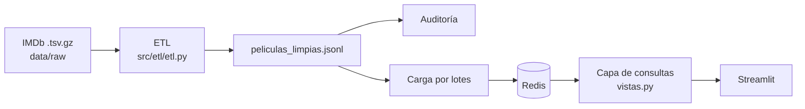

# 🎤 Guía de Exposición (45 min) — Catálogo IMDb sobre Redis

> Proyecto: pipeline ETL masivo + base **clave-valor (Redis)** + capa de consultas + dashboard **Streamlit**, todo dockerizado y testeado.

---

## 0. Cifras clave para tener a mano

| Dato | Valor |
| :--- | :--- |
| Filas crudas totales | > 131 millones (4 archivos `.tsv.gz`, ~1,27 GB comprimidos) |
| Títulos en IMDb (`title.basics`) | 12.904.607 |
| Títulos con votos (`title.ratings`) | 1.726.141 |
| Relaciones título-persona (`title.principals`) | ~102 millones |
| **Producciones finales (JSONL)** | **1.442.508** (689 MB) |
| Personas clave asociadas | ~678.000 |
| Lote de carga a Redis | 2.500 registros por pipeline |
| Umbral ranking por nota | ≥ 100.000 votos |
| Puntaje bayesiano | m = 25 votos, C = 6,9 |

---

## 1. Plan de tiempos

| Bloque | Min | Contenido |
| :--- | :---: | :--- |
| 1. Introducción y problema | 4 | Qué es el proyecto, por qué IMDb, objetivos |
| 2. Fundamentos: bases clave-valor y Redis | 7 | Ventajas, estructuras de datos |
| 3. Arquitectura general | 4 | Flujo de punta a punta |
| 4. Extracción y exploración | 4 | Datasets, descarga atómica |
| 5. ETL en detalle | 9 | 5 pasos, métricas derivadas, balance antes/después |
| 6. Modelo clave-valor en Redis | 7 | Claves, hashes, sets, zsets, KPIs |
| 7. Capa de consultas y app Streamlit | 4 | Vistas + demo |
| 8. Calidad: tests y Docker | 2 | pytest + fakeredis, compose |
| 9. Conclusiones y cierre | 2 | Aprendizajes, mejoras futuras |
| 10. Preguntas | 2 | — |
| **Total** | **45** | |

> Si hay demo en vivo, tomá los minutos del bloque 7 y recortá 1 min a los bloques 5 y 6.

---

## 2. Guion por bloque

### Bloque 1 — Introducción (4 min)
- **Problema:** IMDb publica datasets abiertos gigantes (más de 131 M de filas) en 4 tablas relacionales en inglés, con nulos (`\N`). Consultarlos tal cual es lento e incómodo.
- **Objetivo:** convertirlos en un catálogo limpio, en español, consultable en **milisegundos** para rankings, filtros y KPIs.
- **Propuesta:** ETL → JSONL → Redis → capa de consultas → dashboard.
- **Gancho:** "¿Cómo respondemos 'las mejores películas de acción de los 90 dirigidas por X' sin escanear millones de filas?"

### Bloque 2 — Bases clave-valor y por qué Redis (7 min)
Ver sección 3 de este documento. Puntos a cubrir:
1. Qué es una BD clave-valor (diccionario gigante).
2. Ventajas generales.
3. Estructuras nativas de Redis que usamos.
4. Cuándo **no** conviene (honestidad técnica).

### Bloque 3 — Arquitectura (4 min)

- Cada capa tiene **una sola responsabilidad**; `src/config.py` es la única fuente de verdad (rutas, Redis, nombres de claves).
- [`pipeline.py`](../pipeline.py) orquesta todo: `--estado`, `--descargar`, `--etl`, `--auditar`, `--cargar-redis`, `--todo`.

### Bloque 4 — Extracción y exploración (4 min)
- Fuente: `datasets.imdbws.com`, 4 archivos: `title.ratings`, `title.basics`, `title.principals`, `name.basics`.
- **Descarga atómica:** se baja a `.part` y se renombra al terminar → nunca queda un archivo corrupto.
- **Sin descomprimir:** lectura en streaming con `gzip` (ahorra ~10 GB).
- Scripts de exploración: `explorar_columnas.py` (columnas + 3 filas de ejemplo) y `contar_filas.py` (conteo exacto).

### Bloque 5 — ETL en detalle (9 min)
Mostrar el embudo (de 12,9 M títulos a 1,44 M):

1. **Ratings:** se guardan solo títulos con ≥ 1 voto (`dict` en RAM).
2. **Basics:** se conservan tipos narrativos (película, serie, miniserie, película para TV, episodio) que tengan rating. Se traduce a español, se limpian `\N`, y se calculan:
   - `rango_duracion` (Corta / Estándar / Larga / Épica)
   - `nivel_popularidad` (Baja / Media / Alta / Blockbuster)
   - `puntaje_ponderado` bayesiano:
   $$WR = \frac{v}{v+m}\,R + \frac{m}{v+m}\,C$$
3. **Principals (102 M de filas):** por obra, hasta 2 directores, 2 guionistas y 6 actores. Se acumulan los IDs de personas necesarias en un `set`.
4. **Names:** solo se resuelven los nombres de esas personas (con `break` anticipado al completarlas).
5. **Escritura JSONL:** un JSON por línea → permite cargar a Redis en streaming.

**Decisiones técnicas para mencionar:**
- No se usa pandas: leer 102 M de filas a memoria no es viable; se usa streaming + `dict`/`set` con búsqueda O(1).
- `del ratings` libera memoria tras usarlo.
- Valores faltantes: año/duración `0`, personas `"Desconocido"`.

### Bloque 6 — Modelo clave-valor en Redis (7 min)

| Estructura | Clave | Para qué sirve |
| :--- | :--- | :--- |
| **Hash** | `pelicula:{id}` | Ficha completa de cada título |
| **Set** | `filtro:genero:{g}`, `filtro:decada:{d}`, `filtro:director:{n}`, `filtro:actor:{n}` | Índices secundarios; cruce con `SINTER` |
| **Sorted Set** | `ranking:votos`, `ranking:calificacion`, `ranking:ponderado` | Rankings Top-N con `ZREVRANGE` |
| **String** | `kpi:total_peliculas` | Contador global (`INCR`) |
| **Hash** | `kpi:generos:conteo`, `kpi:decadas:conteo` | KPIs pre-agregados (`HINCRBY`) |

- **Carga masiva:** `pipeline(transaction=False)` en lotes de 2.500 → menos viajes de red.
- **Pre-agregación en la ingesta:** los KPIs ya están calculados al consultar.
- **Regla de negocio:** `ranking:calificacion` solo incluye títulos con ≥ 100.000 votos (evita que un 10/10 con 1 voto encabece).
- Ejemplo a mostrar:
  ```
  SINTER filtro:genero:Acción filtro:decada:1990s filtro:director:Steven Spielberg
  ZREVRANGE ranking:votos 0 9 WITHSCORES
  HGETALL kpi:generos:conteo
  ```

### Bloque 7 — Consultas y app (4 min)
- [`src/consultas/vistas.py`](../src/consultas/vistas.py): funciones como `total_peliculas`, `conteo_por_genero`, `top_por_votos/calificacion/ponderado`, `top_filtrado`, `buscar_peliculas`, `ficha_pelicula`. Separan lógica de datos de la interfaz.
- **App Streamlit** (`app/`):
  - **Inicio:** KPIs (total, géneros, décadas).
  - **Dashboard:** visualizaciones con filtros.
  - **Rankings:** más votadas, mejor calificadas, mejor ponderadas.
  - **Explorador:** búsqueda avanzada y ficha por ID.
- **Demo sugerida (2 min):** Inicio → Rankings (pestaña ponderadas) → Explorador con género + director.

### Bloque 8 — Calidad y despliegue (2 min)
- **8 módulos de tests** con `pytest` + `fakeredis`: corren en memoria, sin internet ni Redis real.
- **Docker Compose:** Redis 7 Alpine (con volumen y healthcheck) + app Streamlit en el puerto 8501.
- Un solo comando: `docker compose run --rm app python pipeline.py --todo`.

### Bloque 9 — Conclusiones (2 min)
- Se redujo > 131 M de filas a **1,44 M de fichas** autocontenidas (689 MB).
- El modelo clave-valor permite consultas en milisegundos porque **se diseña según las consultas**, no según las entidades.
- **Mejoras futuras:** autocompletado con índices por prefijo, más rankings por género, actualización incremental diaria, persistencia/replicación de Redis, caché de pósters.

---

## 3. ¿Por qué es ventajoso usar una base clave-valor (Redis)?

**Idea central:** una base clave-valor es un diccionario gigante: dada una clave, devuelve su valor directamente. No hay joins ni planificador de consultas, así que el costo de acceso es predecible.

### Ventajas
| Ventaja | Explicación |
| :--- | :--- |
| ⚡ **Velocidad extrema** | Opera en memoria RAM; lecturas/escrituras en sub-milisegundos. |
| 🎯 **Acceso O(1) por clave** | `HGETALL pelicula:tt0111161` no depende del tamaño de la base. |
| 🧱 **Estructuras de datos nativas** | Hashes, Sets, Sorted Sets y contadores resuelven problemas completos (rankings, filtros) sin código extra. |
| 🏆 **Rankings gratis** | Un Sorted Set mantiene el orden siempre (skip list, O(log N)); el Top-N es `ZREVRANGE`. |
| 🔍 **Filtros combinados** | `SINTER` cruza índices (género ∩ década ∩ director) sin escanear toda la base. |
| 📊 **KPIs pre-agregados** | `INCR`/`HINCRBY` mantienen contadores en tiempo real; el dashboard solo lee. |
| 🧩 **Esquema flexible** | No hay tablas ni migraciones: se agregan campos o claves sin alterar nada. |
| 📈 **Simplicidad y escalabilidad** | Modelo simple; escala con réplicas y *sharding* (Redis Cluster). |
| 🐳 **Operación liviana** | Una imagen Docker pequeña, arranque inmediato. |

### Contrapartidas (para ser honestos en la defensa)
- **Sin joins ni consultas ad hoc:** hay que diseñar las claves e índices pensando en las consultas (por eso desnormalizamos en el ETL).
- **Memoria cara:** todo vive en RAM; con 1,44 M de títulos y todos los índices hay que dimensionar bien.
- **Duplicación de datos:** los índices secundarios se mantienen manualmente al cargar.
- **No ideal** para consultas analíticas complejas con agregaciones arbitrarias (ahí conviene SQL/columnar).

### Frase de cierre
> "Redis no reemplaza a una base relacional: es la mejor herramienta cuando sabemos de antemano qué preguntas vamos a hacer y necesitamos respuestas inmediatas."

### Comparación rápida (tabla para una diapositiva)
| Criterio | SQL relacional | Redis (clave-valor) |
| :--- | :--- | :--- |
| Modelo | Tablas + joins | Claves + estructuras |
| Latencia típica | ms – cientos de ms | sub-ms |
| Consultas ad hoc | Excelente | Limitada |
| Rankings/contadores en tiempo real | Costoso (ORDER BY / GROUP BY) | Nativo (ZSET / INCR) |
| Esquema | Rígido | Flexible |
| Almacenamiento | Disco (más barato) | Memoria (más caro) |

---

## 4. Posibles preguntas del tribunal (con respuesta corta)

1. **¿Por qué no usaron pandas?** Por memoria: `title.principals` tiene ~102 M de filas; streaming + estructuras hash es más eficiente.
2. **¿Por qué JSONL y no CSV/JSON?** Un registro por línea permite lectura en streaming y listas anidadas (géneros).
3. **¿Por qué limitar a 6 actores y 2 directores/guionistas?** Para acotar memoria e índices; los primeros créditos son los más relevantes.
4. **¿Por qué ranking por nota con 100.000 votos mínimo?** Evita sesgos de obras con pocos votos; el ponderado cubre el resto.
5. **¿Qué pasa si Redis se cae?** La app muestra un error controlado; los datos se recargan desde el JSONL. Redis puede configurarse con persistencia (volumen en Docker).
6. **¿Cómo se actualizarían los datos?** IMDb actualiza a diario: se vuelve a correr `pipeline.py --todo` (mejora futura: carga incremental).
7. **¿Cómo se garantiza la calidad?** Auditoría del JSONL + suite de tests automatizados.
8. **¿Por qué una fórmula bayesiana?** Equilibra nota y cantidad de votos (misma idea que el Top 250 de IMDb).

---

## 5. 🎨 Prompt para generar la presentación

Copiá y pegá el siguiente prompt en tu herramienta (Gemini, ChatGPT, Gamma, Canva Magic Design, Beautiful.ai, etc.):

````text
Actuá como diseñador de presentaciones y experto en ingeniería de datos. Creá una presentación de ~22 diapositivas, en español rioplatense neutro, para una exposición de 45 minutos sobre el proyecto "Catálogo y Análisis de IMDb sobre Redis (modelo clave-valor)".

ESTILO VISUAL
- Tema oscuro moderno, fondo gris carbón (#0F1117), acentos en amarillo IMDb (#F5C518) y rojo Redis (#DC382C), texto blanco.
- Tipografía sans-serif limpia (Inter o Montserrat). Mucho espacio en blanco, máximo 5 líneas por diapositiva, títulos grandes.
- Íconos simples (base de datos, engranaje, rayo, gráfico, contenedor Docker). Evitar texto denso: usar diagramas, tablas y cifras grandes.
- Incluir notas del orador en cada diapositiva con lo que hay que decir (1-3 frases).

ESTRUCTURA (diapositiva por diapositiva)
1. Portada: "Catálogo IMDb sobre Redis" — subtítulo "ETL masivo + base clave-valor + dashboard interactivo". Logos IMDb + Redis.
2. El problema: 4 datasets crudos, +131 millones de filas, en inglés, con nulos. Pregunta gancho: "¿Cómo respondemos en milisegundos sin escanear millones de filas?"
3. Objetivos del proyecto (3 viñetas con íconos).
4. ¿Qué es una base clave-valor? Diagrama de un diccionario: clave → valor. Ejemplo "pelicula:tt0111161" → ficha.
5. Ventajas de Redis: 6 tarjetas (velocidad en RAM, O(1), estructuras nativas, rankings con Sorted Sets, filtros con SINTER, KPIs con INCR).
6. Estructuras de datos de Redis usadas: Hash, Set, Sorted Set, String — una tarjeta con ejemplo de comando cada una.
7. Contrapartidas y cuándo NO usarlo (memoria, sin joins, índices manuales) + tabla comparativa SQL vs Redis.
8. Arquitectura general: diagrama de flujo horizontal RAW → ETL → JSONL → Carga → Redis → Consultas → Streamlit (con Docker envolviendo todo).
9. Extracción: los 4 archivos de IMDb en una tabla (nombre, peso, filas). Resaltar descarga atómica (.part) y lectura gzip sin descomprimir.
10. Cifras de entrada: infografía grande "131 M+ filas · 4 archivos · 1,27 GB".
11. ETL — visión general: embudo de 5 pasos (ratings → basics → principals → names → JSONL).
12. ETL — transformaciones: traducción a español, tipos narrativos, rango de duración, nivel de popularidad.
13. ETL — puntaje ponderado bayesiano: fórmula WR = v/(v+m)·R + m/(v+m)·C, con m=25 y C=6,9, y un ejemplo numérico de por qué evita el sesgo de pocos votos.
14. ETL — decisiones técnicas: streaming sin pandas, estructuras dict/set O(1), límite de 2 directores, 2 guionistas y 6 actores.
15. Resultado del ETL: gráfico de embudo "12,9 M títulos → 1,44 M producciones" y "102 M relaciones → ~678 K personas"; 689 MB de JSONL. Mostrar un registro JSON de ejemplo.
16. Modelo en Redis: tabla de claves (pelicula:{id}, filtro:*, ranking:*, kpi:*) con su estructura.
17. Carga masiva: pipelines de 2.500 registros, pre-agregación de KPIs, regla de ≥100.000 votos para el ranking de nota.
18. Consultas en acción: 3 comandos Redis (SINTER, ZREVRANGE, HGETALL) con su resultado de ejemplo.
19. Capa de consultas y app Streamlit: capturas/mockups de Inicio, Dashboard, Rankings y Explorador.
20. Calidad y despliegue: 8 módulos de tests (pytest + fakeredis), Docker Compose con Redis 7 + app, comando único --todo.
21. Conclusiones y mejoras futuras (carga incremental, autocompletado, persistencia/réplicas, más rankings).
22. Preguntas — "¡Gracias!" con datos de contacto/repositorio.

REQUISITOS
- Mantener coherencia visual entre diapositivas (mismos colores, íconos y tamaños).
- Incluir al menos 3 diagramas (arquitectura, embudo ETL, modelo de claves) y 2 tablas comparativas.
- Usar cifras grandes y destacadas en las diapositivas 2, 10 y 15.
- Cada diapositiva debe poder explicarse en ~2 minutos.
- Entregar además un resumen de 1 línea por diapositiva y las notas del orador.
````

---

## 6. Checklist previo a la exposición
- [ ] `docker compose up -d --build` y datos cargados en Redis antes de empezar.
- [ ] Probar la app en `http://localhost:8501` (Inicio, Rankings, Explorador).
- [ ] Tener a mano `docs/proceso_etl.md` con el detalle del ETL.
- [ ] Ensayar con cronómetro: 45 min incluyendo 2 min de demo y 2 de preguntas.
- [ ] Plan B: capturas de pantalla de la app por si falla la demo en vivo.

