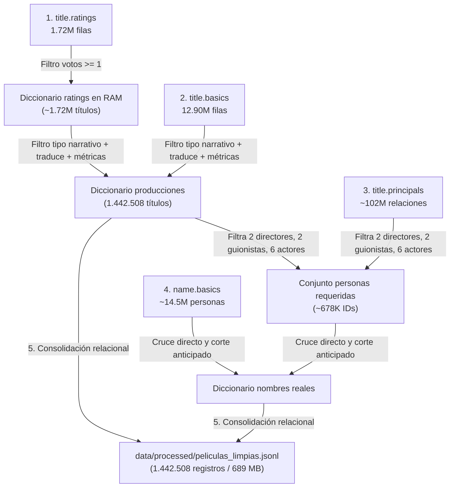

# 📊 Documentación del Proceso ETL - Catálogo IMDb sobre Redis

Este documento detalla la procedencia de los datos, las transformaciones aplicadas durante el pipeline de **ETL (Extracción, Transformación y Carga)** implementado en [`src/etl/etl.py`](file:///c:/Users/Pc/Downloads/Trabajo%20final%20clave-valor/src/etl/etl.py), y el balance cuantitativo final de registros procesados.

---

## 1. 📥 ¿Cómo se obtienen los datos? (Fase de Extracción)

Los datos provienen de los **repositorios públicos y oficiales de IMDb** ([datasets.imdbws.com](https://datasets.imdbws.com/)), los cuales se actualizan diariamente.

En el proyecto, la descarga y verificación está automatizada en [`pipeline.py`](file:///c:/Users/Pc/Downloads/Trabajo%20final%20clave-valor/pipeline.py) a través de la función `descargar_archivos_raw()`:

* **Comando para descargarlos:**
  ```powershell
  python pipeline.py --descargar
  # O dentro de Docker:
  docker compose run --rm app python pipeline.py --descargar
  ```
* **Mecanismo de descarga atómica y segura:**
  Para evitar que una conexión interrumpida deje archivos corruptos o incompletos que luego hagan fallar el pipeline, el script descarga cada dataset en un archivo temporal con extensión `.part`. Solo cuando la descarga se completa al 100%, se renombra automáticamente al nombre definitivo (`.tsv.gz`).
* **Optimización en disco:**
  Los archivos se almacenan en [`data/raw/`](file:///c:/Users/Pc/Downloads/Trabajo%20final%20clave-valor/data/raw) comprimidos en formato `.tsv.gz`. **Nunca se descomprimen en disco** (lo que consumiría más de 10 GB innecesarios); el pipeline los procesa mediante streaming en memoria con la librería nativa `gzip` de Python.

---

## 2. 🗄️ ¿Qué datos teníamos al inicio? (Datasets Crudos de Entrada)

Se parte de **4 archivos masivos** con un volumen combinado que supera los **130 millones de filas**:

| Archivo Crudo (`data/raw/`) | Peso Comprimido | Filas / Registros Crudos | ¿Qué contiene? | Columnas Clave |
| :--- | :---: | :---: | :--- | :--- |
| **`title.ratings.tsv.gz`** | ~8.3 MB | **1.726.141** | Evaluaciones del público (calificación promedio y volumen de votos). | `tconst`, `averageRating`, `numVotes` |
| **`title.basics.tsv.gz`** | ~218 MB | **12.904.607** | Catálogo histórico completo de producciones audiovisuales. | `tconst`, `titleType`, `primaryTitle`, `isAdult`, `startYear`, `runtimeMinutes`, `genres` |
| **`title.principals.tsv.gz`** | ~752 MB | **~102.000.000** | Matriz de créditos y relaciones (quién trabajó en qué obra y con qué rol). | `tconst`, `nconst`, `category` (director, writer, actor, etc.) |
| **`name.basics.tsv.gz`** | ~297 MB | **~14.500.000** | Registro biográfico de personas de la industria. | `nconst`, `primaryName` |
| **TOTAL INICIAL** | **~1.27 GB (comprimido)** | **> 131.000.000 filas** | Tablas relacionales crudas, en inglés y con valores nulos (`\N`). | — |

---

## 3. ⚙️ ¿Qué ocurre durante el proceso de ETL? (`src/etl/etl.py`)

El script ejecuta un pipeline masivo dividido en **5 pasos secuenciales**:



### Paso 1: Filtro de Relevancia por Calificaciones (`title.ratings`)
* Lee las evaluaciones línea por línea.
* Aplica un umbral mínimo: `votos >= 1`.
* Crea un diccionario `ratings[tconst] = (calificacion, votos)` que actúa como primer embudo. De los casi 13 millones de títulos que existen en IMDb, la inmensa mayoría nunca recibió ningún voto.

### Paso 2: Filtrado de Catálogo y Transformaciones de Negocio (`title.basics`)
* Cruza contra el diccionario de ratings: si una obra no tiene votos, se descarta inmediatamente.
* **Filtro de formatos narrativos:** Se descartan videojuegos, videos musicales o podcasts. Solo se conservan producciones narrativas de valor cinematográfico:
  * `movie` $\rightarrow$ *"Película"*
  * `tvSeries` $\rightarrow$ *"Serie"*
  * `tvMiniSeries` $\rightarrow$ *"Miniserie"*
  * `tvMovie` $\rightarrow$ *"Película para TV"*
  * `tvEpisode` $\rightarrow$ *"Episodio"*
* **Traducción y Normalización:** Traduce géneros y tipos al español (ej. *Action* $\rightarrow$ *Acción*, *Sci-Fi* $\rightarrow$ *Ciencia ficción*) y convierte campos numéricos ausentes (`\N`) en valores seguros (`0`).
* **Ingeniería de Características y Métricas Derivadas:**
  1. **Rango de duración:** `clasificar_duracion()` segmenta en *Corta (< 60m)*, *Estándar (60-120m)*, *Larga (120-180m)*, *Épica (> 180m)* o *No especificada*.
  2. **Nivel de popularidad:** `clasificar_popularidad()` agrupa por volumen de votos en *Baja (1-100)*, *Media (101-5K)*, *Alta (5K-50K)* y *Blockbuster (> 50K)*.
  3. **Puntaje Ponderado Bayesiano:** Implementa la fórmula estadística ponderada (similar a la de IMDb Top 250):
     $$WR = \left(\frac{v}{v + m}\right) \cdot R + \left(\frac{m}{v + m}\right) \cdot C$$
     * Donde $v$ = votos de la obra.
     * $m = 25$ = votos mínimos de corte.
     * $R$ = calificación promedio de la obra.
     * $C = 6.9$ = calificación promedio global de la plataforma.
     * *Justificación:* Evita que una obra desconocida con un único voto de 10 encabece el ranking frente a clásicos consolidados con millones de votos.
* Tras este paso se liberan los ratings de la memoria con `del ratings` para cuidar el consumo de RAM.

### Paso 3: Cruce del Elenco Clave (`title.principals`)
* Escanea los **102 millones de relaciones** sin cargar la tabla entera en memoria.
* Solo procesa los registros de las obras ya seleccionadas.
* Para evitar sobrecargar Redis con listas infinitas de extras o técnicos, selecciona:
  * Hasta **2 directores**.
  * Hasta **2 guionistas**.
  * Hasta **6 actores/actrices principales**.
* Extrae los códigos `nconst` de las personas necesarias en un conjunto único `set()`.

### Paso 4: Asociación de Nombres Reales (`name.basics`)
* Escanea el catálogo de personas.
* Si el `nconst` está dentro del conjunto de personas requeridas, mapea su nombre legible (`primaryName`).
* Aplica un corte anticipado (`break`) apenas localiza a todas las personas necesarias, ahorrando minutos de procesamiento.

### Paso 5: Consolidación y Exportación a JSONL
* Ensambla el documento final uniendo la ficha técnica con los nombres de directores, guionistas y actores (o `"Desconocido"` si no había registro).
* Genera el archivo final [`data/processed/peliculas_limpias.jsonl`](file:///c:/Users/Pc/Downloads/Trabajo%20final%20clave-valor/data/processed/peliculas_limpias.jsonl).
* **¿Por qué JSONL (JSON Lines)?:** Al almacenar un objeto JSON por cada línea, permite que la siguiente fase ([`src/carga_redis/cargar_redis.py`](file:///c:/Users/Pc/Downloads/Trabajo%20final%20clave-valor/src/carga_redis/cargar_redis.py)) lea e ingeste por lotes en Redis mediante streaming sin tener que cargar los 689 MB de golpe en la memoria RAM.

---

## 4. 📈 Balance Entrada vs. Salida (¿Con cuántos datos terminamos?)

| Métrica / Concepto | Datos Crudos (Antes) | Datos Limpios (Después) |
| :--- | :---: | :---: |
| **Archivos** | 4 archivos `.tsv.gz` dispersos y relacionales | 1 archivo consolidado [`peliculas_limpias.jsonl`](file:///c:/Users/Pc/Downloads/Trabajo%20final%20clave-valor/data/processed/peliculas_limpias.jsonl) |
| **Total de títulos / producciones** | 12.904.607 títulos | **1.442.508 producciones seleccionadas** |
| **Volumen de relaciones evaluadas** | ~102.000.000 vínculos título-persona | **~678.000 profesionales clave asociados** |
| **Peso en disco** | ~1.27 GB comprimido (~10 GB descomprimido) | **689 MB** |
| **Idioma y estructura** | Columnas en inglés, valores nulos (`\N`) | **Campos en español, tipados y con métricas precalculadas** |

### Estructura de cada registro final resultante:
```json
{
  "id": "tt0111161",
  "tipo": "Película",
  "titulo": "The Shawshank Redemption",
  "titulo_original": "The Shawshank Redemption",
  "es_adulto": false,
  "anio": 1994,
  "anio_fin": 0,
  "duracion": 142,
  "rango_duracion": "Larga (120-180m)",
  "calificacion": 9.3,
  "votos": 2850000,
  "puntaje_ponderado": 9.3,
  "nivel_popularidad": "Blockbuster (> 50K)",
  "generos": ["Drama"],
  "director": "Frank Darabont",
  "guionista": "Stephen King, Frank Darabont",
  "actores": "Tim Robbins, Morgan Freeman, Bob Gunton, William Sadler"
}
```

---

## 5. 🎯 Puntos clave para resaltar en una defensa o exposición oral

1. **Eficiencia en Big Data:** No se utilizó un `pandas.read_csv()` tradicional sobre los 102M de registros porque habría provocado un colapso de memoria (`OutOfMemory`). Se emplearon flujos de lectura línea por línea (`gzip.open`) y estructuras nativas de Python (`set`, `dict`) con acceso en tiempo constante $O(1)$.
2. **Desnormalización orientada al modelo NoSQL (Redis):** Se transformaron 4 tablas relacionales fragmentadas en un catálogo consolidado de documentos independientes, optimizado para poblar directamente `Hashes` de fichas técnicas, `Sets` de filtros e índices secundarios, y `Sorted Sets` de rankings analíticos.
3. **Calidad estadística y mitigación de sesgos:** Se eliminaron obras sin métricas y se aplicó una fórmula estadística bayesiana para que las clasificaciones y analíticas no se distorsionen con obras con valoraciones aisladas.

